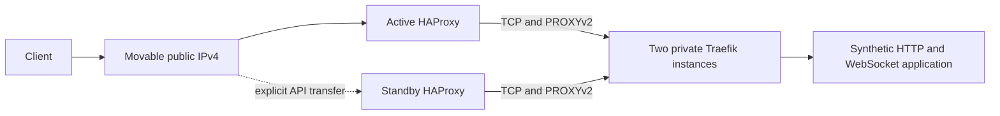

# CLO edge data-plane experiment, 17 November 2026

The tested path is two standalone HAProxy VMs, one movable public IPv4 and two
private Kubernetes nodes running Traefik. **The automatic failover controller is
not implemented. This is a functional experiment, not production acceptance.**

[Sanitized measurements](data-plane-2026-11-17.json).

## Topology

Both edge VMs: 1 shared vCPU, 2 GB RAM, 10 GB boot volume. Both private nodes:
2 shared vCPU, 4 GB RAM, 20 GB boot volume. The existing project NAT and two
reserved IPv4 addresses were reused. The second address remained management
access to the standby. No provider Load Balancer or persistent application PVC
was used. All four nodes belonged to one disposable CLO project.

Kubernetes: v1.36.6+k3s1 (one K3s server and one agent), Traefik:
v3.7.19, HAProxy: 2.8.30-0ubuntu0.24.04.2. Image digests are in the measurements.
This does not qualify the production RKE2 packaging or control-plane HA.

## Results

| Check | Observed result |
|---|---|
| Source address | 57 connections correlated by edge TCP peer IP+port, Traefik ClientAddr and application canonical headers |
| Independent controlled source | A client bound its assigned public IPv4; the application received that exact address |
| Both ingress instances | Used successfully |
| Forged HTTP headers | Canonical XFF/X-Real-IP/Proto/Port replaced; RFC Forwarded removed; alias names deleted |
| Forged PROXYv1/v2 | Claimed source not trusted from an untrusted private source; same HAProxy frontend additionally tested from a private client |
| Private ingress bypass | Other private node could not connect to ports 8000, 8443 or 9000 after filtering |
| Active WS | 187.998 s, correct final echo |
| Idle WSS, no keepalive | 181.774 s, correct final echo, CA and hostname verification enabled |
| Ingress network blackhole | 53 observed requests, 9 failures; failed target DOWN, healthy target UP; both UP after restoration |
| Edge powered off | Old VM explicitly confirmed STOPPED/OFF before address transfer |
| Move command to first HTTPS | 37.828 s |
| Power-off command to first HTTPS | 76.764 s |
| Last-success to first-success gap | 74.511 s |
| WebSocket after edge loss | Existing session unusable (ConnectionClosedError); new WSS connection succeeded |
| Standby during transfer | Same boot ID and HAProxy service start/restart counters |

The power-off interval includes the experiment waiting for the old WebSocket
read/close to fail before requesting the IP move. It excludes automatic failure
detection because no automatic controller was involved. Existing TCP/WebSocket
sessions do not migrate with an IP address; clients must reconnect.

The ingress fault was a controlled DROP of the two edges' traffic to one
node's data/health ports. It was not a hypervisor or whole-node power failure.
The other ingress continued serving. The maximum observed request duration was
1.503 s; observer/network errors are included in counts.

## Configuration properties that mattered

HAProxy passes TLS through to Traefik and sends PROXYv2 on both HTTP and TLS
backend connections. The public frontend does not enable accept-proxy. Backend
health uses HTTP /ping on a separate private port, with independent health-check
protocol settings. [HAProxy configuration reference](https://docs.haproxy.org/2.8/configuration.html).

Traefik trusts PROXY metadata only from the two edge private /32 addresses.
Incoming forwarded headers are not globally trusted. HTTP and TLS use explicit
routes; certificates remain in Kubernetes. RFC Forwarded is removed. Entrypoint
http.aliasHeadersStrategy=delete also removes header names containing aliases
such as underscores, dots and exclamation marks, which matter for PHP-style
header normalization. Before hardening, dot/exclamation aliases reached the
synthetic backend; after hardening all tested aliases disappeared while the
canonical client address remained correct.
[Traefik entrypoints](https://doc.traefik.io/traefik/reference/install-configuration/entrypoints/).

Host filtering permits the two edges and local node health checks to reach the
private ingress ports. Parser trust was tested before this network filter,
then direct access from the other private node was verified blocked.

## Method and limits

The initial attempt used an unresolvable .invalid hostname; those workstation
requests did not produce ingress traffic. The lab then used a temporary DNS
hostname resolving to the actual VIP, with its matching private test CA/SAN.
No production DNS was changed. Earlier aborted attempts are not counted as
successful acceptance. Four VMs at a time were used; the first batch was fully
removed before the final batch was created.

Functional GETs record and retry transport failures, never failed header/IP or
certificate assertions. Fault observers use one attempt per sample, with no
retry hiding an outage. WebSocket handshakes can retry network errors; after
opening, the entire active/idle interval must pass without reconnecting.
Transport failures by probe type are retained in the sanitized measurements.
An external malformed-PROXY attempt being rejected does not independently prove
where it was rejected; the same frontend was also exercised from a controlled
private client to cover the actual HAProxy/Traefik parser boundary.

No throughput benchmark, IPv6, prolonged outage, concurrent-controller race,
cloud API failure, automatic fencing, SIP/RTP or production-data migration was
qualified. The CSI native-volume expansion limitation remains a separate issue.

## Stop-state and evidence details

During shutdown, switch_status was OFF while the VM status was still STOPPING.
The measured terminal STOPPED/OFF state took about 32 seconds. The final transfer
waited for **both STOPPED and OFF**, verified that the old WSS was physically on
the powered-off edge using its kernel TCP table, and confirmed it became unusable.
OFF alone is insufficient as a terminal fencing predicate; CSI already uses the
stricter pair. Observed transitions are included in the measurements.

WebSocket forwarded schemes were ws/wss (HTTP requests use http/https); the
original protocol and port were checked accordingly. One preparatory readiness
GET after deliberately restarting the old edge was excluded from TCP-log
correlation because its final TCP log was not collected before shutdown. Its
application and ingress source fields agreed; it is explicitly counted as an
uncorrelated warmup, not a verified connection. All acceptance samples remained
subject to the exact peer/header assertions.

The success gap uses request-start timestamps of the last successful probe
before transfer and the first successful probe after transfer. It includes the
observer path and sampling interval, not only provider routing convergence.

## Cleanup

All four VM IDs and all four boot-volume IDs returned 404 in a separate API
audit. Project inventory returned to its exact initial baseline: no VMs,
volumes, Load Balancers or keypairs; the previous NAT and three external address
resources remained, including the same two reserved IPv4 addresses free.
No raw addresses, account/project IDs, credentials, private keys or operational
logs are included in the published measurements.
